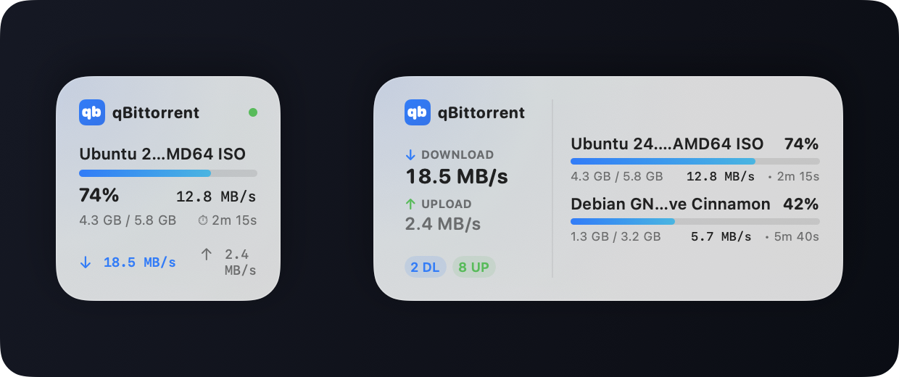

# ⚡️ QBMenubar — Native macOS Menu Bar & Desktop Widget Client for qBittorrent & Transmission

<p align="center">
  
</p>

<p align="center">
  <a href="https://github.com/133hou/QBMenubar/releases"></a>
  <a href="https://github.com/133hou/QBMenubar/releases"></a>
  
  
  
  
  
  
</p>

<p align="center">
  <b>English</b> | 
  <a href="README_zh.md">简体中文</a> | 
  <a href="README_zh-Hant.md">繁體中文</a> | 
  <a href="README_ja.md">日本語</a> | 
  <a href="README_ko.md">한국어</a> | 
  <a href="README_de.md">Deutsch</a> | 
  <a href="README_fr.md">Français</a> | 
  <a href="README_es.md">Español</a> | 
  <a href="README_ru.md">Русский</a>
</p>

**QBMenubar** is the ultimate lightweight, ultra-responsive native **qBittorrent macOS menu bar app** and **Transmission remote GUI for Mac**, engineered in pure **Swift 6 + SwiftUI + MenuBarExtra (.window)**. It serves as the modern **Apple Silicon native BitTorrent manager** and **Transgui (Transmission Remote GUI) alternative**, bringing cutting-edge **Liquid Glass** translucent aesthetics, interactive macOS **desktop widgets**, and **Apple Motion Feel** spring physics directly to your Mac's status bar. Whether managing local downloads, monitoring home NAS storage (**Synology, QNAP, Unraid, TrueNAS, Docker**), or tracking high-speed **PT / private tracker seedboxes**, QBMenubar delivers zero-overhead real-time monitoring and remote control.

<p align="center">
  
</p>

## 🧭 Quick Navigation
- [🎯 Use Cases & Key Scenarios](#use-cases)
- [📸 Screenshots & UI Showcase](#screenshots)
- [📊 Feature Comparison: Why QBMenubar?](#comparison)
- [✨ Features & Highlights](#features)
  - [🧩 Desktop Widgets (Zero Permission Sync)](#desktop-widgets)
- [🔒 Security, Privacy & Reliability](#security)
- [🚀 What's New in v1.3.2](#whats-new)
- [📥 Installation & Download](#installation)
- [⚙️ Configuration (1-Minute Quick Start)](#configuration)
- [❓ Frequently Asked Questions (FAQ)](#faq)
- [🏷️ Keywords & Search Topics](#keywords)
- [📄 License](#license)

---

<a id="use-cases"></a>
## 🎯 Use Cases & Key Scenarios

- 🚀 **Local & Remote NAS Monitoring**: Effortlessly monitor and control qBittorrent and Transmission running on your local Mac, **Synology DSM, QNAP, Unraid, TrueNAS, Docker** containers, or remote Linux seedboxes via LAN IP, DDNS domain, or HTTPS reverse proxy.
- 📌 **Menu Bar Progress Pinning**: Pin any mission-critical torrent's live download percentage directly next to your macOS clock (e.g. `↓ 12.0 MB/s 85%`) — ideal for **PT / private tracker seedbox monitoring**.
- ⚡️ **Zero Resource Overhead**: Native compiled Swift 6 universal binary (Apple Silicon M1/M2/M3/M4 & Intel) with ~0.0% idle CPU and under 40 MB RAM — virtually invisible to battery and system performance unlike heavy browser tabs or Electron wrappers.
- 🐢 **One-Click Quick Actions**: Instantly pause/resume all torrents, toggle Alternate Speed Limits (Turtle Mode 🐢) during Zoom meetings or gaming sessions, or open WebUI with one click.
- 📋 **Seamless Torrent Ingestion**: Automatically detects magnet links (`magnet:?xt=`) and `.torrent` URLs from your clipboard, plus full `.torrent` file parsing with pre-download file inspection and target path selection.
- 🖥️ **qBittorrent Desktop Widget for macOS**: Glanceable Small, Medium, and Large desktop and Notification Center widgets powered by WidgetKit, updating without opening the app or browser.

---

<a id="screenshots"></a>
## 📸 Screenshots & UI Showcase

<p align="center">
  
  &nbsp;&nbsp;&nbsp;&nbsp;
  
</p>

<p align="center">
  <em>Liquid Glass Circular Ring Style (New):</em><br />
  
</p>

<p align="center">
  <em>Classic Linear Capsule Bar Style (Preserved):</em><br />
  
</p>

<p align="center">
  
</p>

---

<a id="comparison"></a>
## 📊 Feature Comparison: Why QBMenubar?

| Feature | QBMenubar (Native Mac App) | WebUI in Browser | Official Qt Desktop Client | Transgui / Script Plugins |
|---|:---:|:---:|:---:|:---:|
| **Dual-Client Engine** | ✅ **qBittorrent & Transmission** | ❌ (Single instance) | ❌ qBittorrent only | ⚠️ Single client / legacy |
| **Menu Bar Resident** | ✅ Native Liquid Glass | ❌ (Window only) | ❌ (Dock/Window only) | ⚠️ Text only (No UI) |
| **Pinned Torrent Progress** | ✅ Direct status bar badge | ❌ | ❌ | ❌ |
| **Real-time Speed Waveform** | ✅ Swift Charts smooth wave | ⚠️ Static graph | ⚠️ Basic graph | ❌ |
| **Stretchable Window Height** | ✅ Interactive resize (380-920pt) | ⚠️ Manual window | ⚠️ Complex window | ❌ Fixed text |
| **Memory Consumption** | 🟢 **~35 - 45 MB** | 🔴 300 MB - 1 GB+ | 🟡 150 MB - 300 MB | 🟢 ~30 MB |
| **CPU Idle Usage** | 🟢 **< 0.1%** | 🟡 1% - 5% | 🟡 1% - 3% | 🟡 1% - 2% |
| **Remote NAS & Docker Support**| ✅ Local, LAN, NAS & HTTPS | ✅ | ❌ Local instance only | ⚠️ Limited auth |
| **Expandable File Tree Preview**| ✅ Interactive list | ⚠️ Multi-click table | ⚠️ Cluttered table | ❌ |
| **Desktop & Notification Center Widgets**| ✅ Small, Medium & Large (WidgetKit) | ❌ | ❌ | ❌ |
| **macOS Native System Notifications**| ✅ Download complete | ⚠️ Browser permission | ⚠️ Legacy alert | ❌ |
| **Apple Silicon M-Series Native**| ✅ Pure Swift 6 universal | ⚠️ Web process | 🟡 Rosetta / Fat Qt | ⚠️ Script dependent |

---

<a id="features"></a>
## ✨ Features & Highlights

1. **Status Bar Speed & Progress Item**:
   - Real-time download and upload speeds with dynamic directional glyphs (`↓` / `↑`).
   - Pinned torrent progress percentage with unified monochrome badge styling.
   - Dynamic adaptive width calculation — zero truncated labels or flickering.
2. **Liquid Glass Popover Panel**:
   - Native macOS translucent Liquid Glass material with specular rim highlights.
   - **Interactive Bandwidth Waveform** powered by Swift Charts with smooth forward interpolation.
   - Quick actions bar: **Pause All**, **Resume All**, **Alternate Speed Limits (🐢)**, and **WebUI**.
   - Filter tabs with badge counters: *All*, *Downloading*, *Seeding*, and *Paused*.
   - **➕ Upload Torrent**: Parse `.torrent` metadata, inspect file tree, and choose destination path before downloading.
   - **📋 Clipboard Sniffer**: Instant prompt when copying `magnet:?xt=` or `.torrent` web links.
3. **Interactive Torrent Cards**:
   - Rich metrics: progress bars, ETA, size counters, seed/peer ratios, and upload/download speeds.
   - **File Tree Viewer**: Expand any card to inspect individual files with dedicated filetype icons and completion percentages.
   - **📌 Pin to Status Bar**: Lock your current download to the macOS menu bar with a single click.
   - Context Menu: Reveal in Finder, force recheck hash, pause, resume, or delete (with or without files).
4. **macOS System Settings Style Preferences**:
   - Native dual-pane layout without sidebar collapse toggles.
   - Comprehensive multi-language localization (English, 简体中文, 繁體中文, 日本語, 한국어, Deutsch, Français, Español, Русский).
   - In-app **Connectivity Diagnostic Tool** with real-time ping latency and qBittorrent version detection.
   - Full reverse proxy, subpath prefix (`/api/v2`), and localhost bypass support.
5. **macOS Desktop & Notification Center Widgets (WidgetKit)**:
   - **Small Widget (`.systemSmall`)**: Glanceable single-task progress card featuring hero active torrent progress, live download/upload speeds, and remaining ETA.
   - **Medium Widget (`.systemMedium`)**: Split-panel layout displaying global real-time bandwidth metrics alongside top downloading tasks with progress bars.
   - **Large Widget (`.systemLarge`)**: Full download dashboard with active torrent listings, state badges, transfer rates, and instant deep-linking into QBMenubar.
   - **Zero Overhead Local Snapshot Storage**: Seamless background sync between the menu bar daemon and macOS Notification Center.
   - Native support for macOS Full Color, Tinted, and Accented modes (`widgetAccentable`).

<a id="desktop-widgets"></a>
### 🧩 Desktop Widgets (WidgetKit) — Zero Permission Required

QBMenubar delivers native macOS Desktop & Notification Center Widgets across three sizes (`Small`, `Medium`, and `Large`), keeping your active downloads and network speeds glanceable at all times.

1. **Enable in Settings**: Open QBMenubar Preferences (**⌘,**) -> **Widgets** tab -> turn on **Enable Desktop Widget Sync**.
2. **Zero Permission Required (No Full Disk Access)**:
   - **🔒 Native Sandbox & Privacy**: Desktop Widgets sync via an optimized local snapshot system. Unlike older utilities that required elevated privileges, QBMenubar requires **no Full Disk Access** and accesses zero user files or personal data.
   - **🔋 Smart WidgetKit Budget Throttling**: Updates are synchronized with macOS WidgetKit reload budgets to conserve MacBook battery life, avoiding aggressive background polling while maintaining timely status updates.
   - **🛡️ Clean Empty & Disconnected States**: When qBittorrent or Transmission is offline or no downloads are active, widgets automatically display clean, self-healing status cards without crashing or displaying stale data.
3. **Adding Widgets to Desktop**:
   - Right-click anywhere on your macOS desktop -> click **"Edit Widgets..."** (or open Notification Center and click **"Edit Widgets"** at the bottom).
   - In the left sidebar or search box, search for **`QBMenubar`** or **`qBittorrent`**.
   - Pick from **Small**, **Medium**, or **Large** widgets and drag it directly onto your desktop or Notification Center.

---

<a id="security"></a>
## 🔒 Security, Privacy & Reliability

QBMenubar is engineered with enterprise-grade security and data integrity as top priorities:

- 🔐 **macOS Keychain Encrypted Credentials**: WebUI authentication passwords are encrypted and stored directly in the native **macOS Keychain Services**, completely eliminating plaintext storage in `UserDefaults` or configuration files.
- 🔋 **Smart Battery-Friendly WidgetKit Throttling**: Employs adaptive reload throttling (coalesced 15-minute budget windows and smart state tracking) to prevent battery drain on MacBooks while keeping widgets responsive.
- 🌐 **Hardened Networking (RFC 3986 Standard)**: Strict percent-encoding ensures authentication passwords with special characters (`@`, `#`, `$`, `%`, `&`, `+`) and complex magnet links transmit without corruption or truncation.
- 🛡️ **Transmission CSRF Concurrency Safety**: Manages Transmission JSON-RPC 409 Session-ID tokens with thread-safe serialization, preventing race conditions during concurrent network calls.
- 📦 **Protected Bencode Parser**: Built-in 256-level recursion nesting depth limits and integer overflow guards protect against maliciously crafted `.torrent` files.

---

<a id="whats-new"></a>
### 🚀 What's New in v1.3.2
- **Native Transmission Client Support**: Fully decoupled service architecture natively supporting Transmission JSON-RPC (with automatic 409 CSRF Session-Id handshake and Basic Auth). Seamlessly switch between qBittorrent and Transmission with 100% feature parity across desktop widgets, speed graphs, and task management.
- **macOS Keychain Password Encryption & Hardened Security**: WebUI passwords now securely reside in the macOS Keychain. Networking is hardened with RFC 3986 form encoding, concurrent Transmission CSRF token safety, and recursion-protected Bencode parsing.
- **Smart WidgetKit Reload Throttling (Zero Permission)**: Eliminated Full Disk Access requirements. Desktop widgets now sync efficiently via local snapshots with battery-friendly refresh budget throttling.
- **Liquid Glass Optical Selection Lens in Settings**: Crystal clear optical glass lens with 3D meniscus refraction shadows, prismatic chromatic dispersion, and seamless spring motion matching native macOS Tahoe feel (classic solid style switchable in General Settings).
- **Liquid Glass Circular Progress Ring for Widgets**: Directional flow arrow tip, frosted glass track, and central floating squircle status indicator (classic linear capsule progress bar preserved in Preferences -> Widgets).
- **Native WidgetKit Extension Entry Point**: Configured `_NSExtensionMain` entry point for the SwiftPM WidgetKit binary, ensuring robust ExtensionKit launch, descriptor discovery, and placeholder precaching by macOS `chronod`.
- **Clean Single-Bundle Registration**: Eliminated redundant binary registrations and ensured clean system discovery.

---

<a id="installation"></a>
## 📥 Installation & Download

### Option 1: Direct Download (Recommended)
Download the precompiled and signed macOS App directly from GitHub Releases:

👉 **[Download QBMenubar (Latest Release)](https://github.com/133hou/QBMenubar/releases/latest)**

1. Download and unzip `QBMenubar-*-macOS.zip`.
2. Drag `QBMenubar.app` into your **Applications** folder (`/Applications`).
3. Double-click `QBMenubar.app` to launch! It lives quietly in your menu bar.

> [!TIP]
> **macOS Gatekeeper First-Launch Tip:**  
> If macOS alerts that the app *"cannot be opened because Apple cannot check it for malicious software"* (standard for unsigned open-source apps):  
> Simply **Right-click** (or Control-click) `QBMenubar.app` in Finder, select **Open**, and click **Open** in the dialog.  
> Alternatively, run in Terminal: `xattr -cr /Applications/QBMenubar.app`

### Option 2: Build from Source
Requirements: macOS 14.0+, Xcode 15+ / Swift 6.0+.

```bash
git clone https://github.com/133hou/QBMenubar.git
cd QBMenubar
swift build -c release
./build_app.sh
open QBMenubar.app
```

---

<a id="configuration"></a>
## ⚙️ Configuration (1-Minute Quick Start)

### For qBittorrent Users:
1. **Enable WebUI**: In qBittorrent, open **Preferences -> Web UI** and check **Web User Interface (Remote control)** (default port `8080`).
2. **Connect in QBMenubar**: Open QBMenubar Settings -> **WebUI Connection**, choose **qBittorrent**, verify `http://127.0.0.1:8080` and `/api/v2`, enter credentials, and click **Test Connection**.

### For Transmission Users:
1. **Enable RPC Remote Control**: In Transmission, open **Preferences -> Remote** and check **Enable remote access** (default port `9091`).
2. **Connect in QBMenubar**: Open QBMenubar Settings -> **WebUI Connection**, switch **Client Type** to **Transmission**. It automatically presets `http://127.0.0.1:9091` and `/transmission/rpc`. Enter credentials if enabled, and click **Test Connection**!

---

<a id="faq"></a>
## ❓ Frequently Asked Questions (FAQ)

<details>
<summary><b>1. Is QBMenubar a good alternative to Transmission Remote GUI (Transgui) on macOS?</b></summary>
Yes, absolutely. While <i>Transmission Remote GUI (Transgui)</i> was historically popular, it is built with legacy Pascal/Lazarus frameworks, lacks modern macOS UI integration, and does not support Apple Silicon natively. QBMenubar is built from scratch in Swift 6 for Apple Silicon and Intel Macs. It supports both <b>Transmission and qBittorrent</b>, features modern macOS Liquid Glass aesthetics, lives unobtrusively in your menu bar, provides native macOS Desktop Widgets, and consumes virtually zero CPU (&lt;0.1%) and RAM (~40MB).
</details>

<details>
<summary><b>2. How does QBMenubar store my WebUI password securely?</b></summary>
Your credentials are encrypted and stored in the secure <b>macOS Keychain</b> using Apple's native Security framework (<code>kSecClassGenericPassword</code>). Passwords are never saved in plaintext in <code>UserDefaults</code>, preferences plists, or exported configuration files. When connecting to your WebUI, credentials are retrieved from the Keychain into memory only for authentication requests.
</details>

<details>
<summary><b>3. Can I use QBMenubar with both qBittorrent and Transmission?</b></summary>
Yes! QBMenubar features a unified client abstraction architecture. Simply select either <b>qBittorrent</b> or <b>Transmission</b> in <b>Settings -> WebUI Connection</b>. All status bar speeds, popover cards, speed waveforms, and desktop widgets seamlessly support both backends.
</details>

<details>
<summary><b>4. How do I monitor a remote Synology, TrueNAS, Unraid, or Docker container?</b></summary>
Enter your remote device's IP address (e.g. <code>http://192.168.1.100:8080</code> or <code>http://nas.local:9091</code>), domain name, or HTTPS reverse proxy URL in the Server Address field. QBMenubar works flawlessly across LAN, VPN (Tailscale, WireGuard), and WAN reverse proxies with subpaths.
</details>

<details>
<summary><b>5. How do I add Desktop Widgets in macOS Sonoma, Sequoia, and Tahoe?</b></summary>
Right-click any empty space on your macOS desktop (or open Notification Center and click <b>Edit Widgets</b> at the bottom), search for <b>QBMenubar</b>, and drag your preferred widget size (<b>Small</b>, <b>Medium</b>, or <b>Large</b>) onto your desktop. You can choose between the <b>Liquid Glass circular ring</b> and <b>classic linear capsule bar</b> in Preferences. No Full Disk Access or special permissions are required.
</details>

<details>
<summary><b>6. Why does QBMenubar use under 40 MB of RAM while browser tabs use hundreds of MB?</b></summary>
QBMenubar is 100% natively compiled in pure <b>Swift 6 and SwiftUI</b> with zero web view engines, zero Chromium runtimes, and zero JavaScript overhead. It communicates with your backend via lightweight JSON/REST/RPC requests, using virtually zero CPU (&lt;0.1%) when idle.
</details>

<details>
<summary><b>7. Can I resize or stretch the menu bar popover window?</b></summary>
Yes! Grab the subtle capsule handle at the very bottom center of the popover window and drag it up or down to adjust the height anywhere between <b>380pt and 920pt</b>. Your custom height is remembered automatically, and double-clicking the handle snaps it back to the default height.
</details>

---

<a id="keywords"></a>
## 🏷️ Keywords & Search Topics
`qbittorrent` • `transmission` • `qbittorrent-macos` • `qbittorrent-menu-bar` • `transmission-remote-gui` • `transgui-alternative` • `transmission-mac` • `qbittorrent-remote` • `transmission-rpc` • `qbittorrent-webui` • `macos-menubar` • `menubar-app` • `menubar-extra` • `widgetkit` • `desktop-widgets` • `swiftui` • `swift6` • `liquid-glass` • `bittorrent-client` • `seedbox-monitor` • `pt-client` • `private-tracker` • `synology-nas` • `qnap` • `unraid` • `truenas` • `docker-torrent` • `apple-silicon` • `macos-tahoe` • `macos-sequoia` • `macos-sonoma`

---

<a id="license"></a>
## 📄 License
Distributed under the MIT License. See [LICENSE](LICENSE) for more details.
