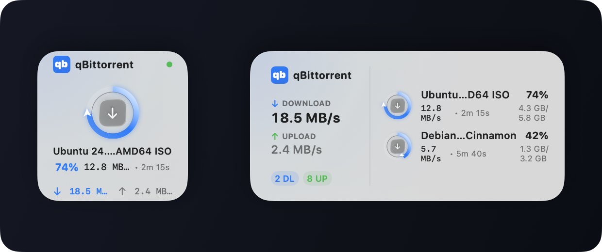

# QBMenubar - macOS ネイティブ qBittorrent メニューバーコントローラー

  

  
  
  
  
  
  

  <a href="README.md">English</a> | 
  <a href="README_zh.md">简体中文</a> | 
  <a href="README_zh-Hant.md">繁體中文</a> | 
  <b>日本語</b> | 
  <a href="README_ko.md">한국어</a> | 
  <a href="README_de.md">Deutsch</a> | 
  <a href="README_fr.md">Français</a> | 
  <a href="README_es.md">Español</a> | 
  <a href="README_ru.md">Русский</a>

**QBMenubar** は、**Swift 6 + SwiftUI + MenuBarExtra (.window)** を用いて完全ネイティブで構築された軽量・高機能な macOS メニューバーアプリケーションです。先進的な **Liquid Glass（リキッドグラス）** 半透明マテリアルと **Apple Motion Feel** のネイティブ物理スプリングアニメーションを融合し、CPU負荷 0.1% 未満、メモリ約40MBの超低リソースで qBittorrent のリアルタイム速度監視、タスク進捗ピン留め、リモート NAS WebUI 管理を実現します。

  

---

## 🎯 主な利用シーン (Use Cases)

- 🚀 **ローカル & リモート NAS 統合監視**：Mac ローカル、Synology DSM、QNAP、Unraid、TrueNAS、Docker コンテナ、リモート VPS 上で動作する qBittorrent を、LAN IP、ドメイン、HTTPS リバースプロキシ経由でシームレスに遠隔制御。
- 📌 **特定タスクのメニューバー進捗固定（Pin）**：重要なダウンロードタスクを1クリックでピン留めし、メニューバーの時計横に進捗パーセンテージ（例: `↓ 12.0 MB/s 85%`）を常時表示。
- ⚡️ **極小リソース消費のバックグラウンド常駐**：Electron ラッパーや常時ブラウザタブと異なり、Swift 6 ネイティブバイナリのためアイドル時 CPU 0.0%、メモリ約 35〜45MB でバッテリーを消費しません。
- 🐢 **ワンクリック一時停止 & 制限切り替え**：オンライン会議やゲーム中に全タスク一時停止や代替速度制限（🐢 カメモード）を瞬時に切り替え可能。
- 📋 **マグネットリンク自動検知 & ファイルツリー確認**：クリップボードの `magnet:` リンクや URL を自動検知し、`.torrent` ファイルのダウンロード前内部構造プレビューにも対応。

---

## 📸 スクリーンショット & 実機プレビュー

  
  &nbsp;&nbsp;&nbsp;&nbsp;
  

  

---

## 📊 機能比較：なぜ QBMenubar なのか？

| 機能・指標 | QBMenubar (ネイティブ) | ブラウザ WebUI | 公式 Qt クライアント | Python / SwiftBar プラグイン |
|---|:---:|:---:|:---:|:---:|
| **メニューバー常駐 & UI** | ✅ ネイティブ Liquid Glass | ❌ Web 画面のみ | ❌ Dock/大画面のみ | ⚠️ テキストのみ |
| **特定タスク進捗ピン留め** | ✅ メニューバーにバッジ直出し | ❌ | ❌ | ❌ |
| **リアルタイム帯域波形** | ✅ Swift Charts 滑らか物理波形 | ⚠️ 静的更新折れ線 | ⚠️ 簡易グラフ | ❌ |
| **メモリ消費量** | 🟢 **~35 - 45 MB** | 🔴 300 MB - 1 GB+ | 🟡 150 MB - 300 MB | 🟢 ~30 MB |
| **アイドル時 CPU 負荷** | 🟢 **< 0.1%** | 🟡 1% - 5% | 🟡 1% - 3% | 🟡 1% - 2% |
| **リモート NAS & Docker 接続** | ✅ LAN / NAS / HTTPS 反代 | ✅ | ❌ ローカル限定 | ⚠️ 認証制限あり |
| **ファイルツリー展開プレビュー** | ✅ カード内で階層展開 & 進捗 | ⚠️ 複数回クリックの表 | ⚠️ 密集した表 | ❌ |
| **デスクトップ & 通知センター ウィジェット (WidgetKit)** | ✅ 小・中・大の3サイズ対応 | ❌ | ❌ | ❌ |
| **macOS ネイティブ通知** | ✅ 完了通知プッシュ | ⚠️ ブラウザ許可必要 | ⚠️ 旧式アラート | ❌ |

---

## ✨ 主な機能一覧

1. **メニューバー常駐モニター**:
   - リアルタイムの上り/下り速度表示と動的矢印アイコン（`↓` / `↑`）。
   - ピン留めタスクの進捗パーセンテージ（モノクロカプセルバッジ）。
   - テキスト幅の動的追従による文字切れ防止。
2. **Liquid Glass ポップオーバーパネル**:
   - macOS の最新液態マテリアルデザイン、スペキュラハイライトエッジ。
   - Swift Charts によるリアルタイム帯域波形グラフ。
   - クイックアクション：全一時停止、全再開、代替速度制限（🐢）、WebUI 起動。
   - フィルタータブ：すべて、ダウンロード中、シード中、一時停止中。
   - **➕ ローカル Torrent 追加**：追加前にファイル一覧・サイズを確認し、保存先ディレクトリを指定可能。
3. **インタラクティブな Torrent カード**:
   - タスク名、ステータス、進行バー、サイズ、ETA、速度を一目で把握。
   - カードをクリックするとファイル一覧がスムーズに展開し、ファイル種別アイコンと個別進捗を表示。
   - 右クリックメニュー：Finder で表示、ハッシュ再チェック、削除（ファイル保持選択可能）。
4. **macOS システム設定風 プレファレンス**:
   - 固定2ペインレイアウト。
   - 9言語の完全ローカライズ（日本語、英語、中国語簡体/繁体、韓国語、ドイツ語、フランス語、スペイン語、ロシア語）。
   - リアルタイム Ping 遅延・サーバーバージョン測定ツール内蔵。
5. **macOS デスクトップ & 通知センター ウィジェット (WidgetKit)**:
   - **小サイズ (`.systemSmall`)**: 最もアクティブなダウンロードタスクの進行状況、リアルタイム転送速度、残り時間（ETA）をコンパクトに表示。
   - **中サイズ (`.systemMedium`)**: 2ペインレイアウト。左側にリアルタイムの全体帯域幅とタスク数、右側にアクティブなダウンロードタスクのプログレスバーを一覧表示。
   - **大サイズ (`.systemLarge`)**: フルダウンロードダッシュボード。帯域サマリー、タスク一覧、ステータスバッジ、QBMenubar への即座ジャンプを統合。
   - **ゼロオーバーヘッド App Group 共有ストレージ**: メニューバー常駐プロセスと macOS 通知センター・デスクトップ間の超軽量同期。
   - macOS のフルカラー、ダーク、着色・アクセント（`widgetAccentable`）モードに完全準拠。

---

## 📥 インストールと起動

### 方法 1: リリース版バイナリの直接ダウンロード（推奨）
Xcode や開発環境不要ですぐに使えます：

👉 **[QBMenubar 最新版をダウンロード (macOS)](https://github.com/133hou/QBMenubar/releases/latest)**

1. `QBMenubar-*-macOS.zip` を解凍します。
2. `QBMenubar.app` を **「アプリケーション (/Applications)」** フォルダへ移動します。
3. **`QBMenubar.app` をダブルクリックして起動**します！メニューバーに常駐します。

> [!TIP]
> **初回起動時の Gatekeeper 警告について:**  
> 「開発元を検証できないため開けません」と表示された場合は、Finder で **`QBMenubar.app` を右クリック（または Control キーを押しながらクリック）** して **「開く」** を選択してください。

---

## 🏷️ 検索キーワード (Keywords)
`qbittorrent` • `qbittorrent-controller` • `qbittorrent-webui` • `qbittorrent-client` • `macos-menubar` • `menubar-app` • `menubar-extra` • `swiftui` • `swift6` • `liquid-glass` • `torrent-client` • `torrent-manager` • `bittorrent` • `nas` • `synology` • `unraid`

---

## 📄 ライセンス
本プロジェクトは [MIT License](LICENSE) のもとで公開されています。
