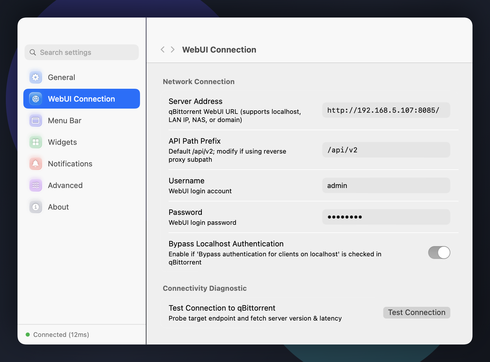

# QBMenubar - macOS 向け qBittorrent メニューバーコントローラー

<p align="center">
  <a href="https://github.com/133hou/QBMenubar/releases"></a>
  
  
  
</p>

<p align="center">
  <a href="README.md">English</a> | 
  <a href="README_zh.md">简体中文</a> | 
  <a href="README_zh-Hant.md">繁體中文</a> | 
  <b>日本語</b> | 
  <a href="README_ko.md">한국어</a> | 
  <a href="README_de.md">Deutsch</a> | 
  <a href="README_fr.md">Français</a> | 
  <a href="README_es.md">Español</a> | 
  <a href="README_ru.md">Русский</a>
</p>

**Swift 6 + SwiftUI + MenuBarExtra (.window)** で構築された、軽量で高パフォーマンスな macOS ネイティブメニューバー常駐アプリです。**Liquid Glass（リキッドグラスマテリアル）** の美しい視覚効果と **Apple Motion Feel** の物理スプリングアニメーションを採用し、Mac のステータスバーからいつでも qBittorrent のダウンロード状況を監視・管理できます。

<p align="center">
  
</p>

---

## 画面プレビュー

<p align="center">
  
  &nbsp;&nbsp;&nbsp;&nbsp;
  
</p>

---

## 主な機能

1. **メニューバーステータス表示**:
   - リアルタイムの上り／下り速度インジケーター。
   - ピン留めタスクの進捗率をメニューバーに直接表示（例: `↓ 12.0 MB/s 85%`）。
   - AppKit のステータスバー幅に最適化され、文字切れを起こしません。
2. **Liquid Glass ポップオーバーパネル**:
   - リアルタイムの帯域波形グラフ（Swift Charts）でトラフィックの推移を表示。
   - クイックアクションバー: 全て一時停止、全て再開、オルタネート速度制限（🐢 カメ）、WebUI 開く。
   - フィルタタブ（すべて、ダウンロード中、シード中、一時停止中）。
   - **➕** ボタンから `.torrent` ファイルを選択し、追加前にファイル一覧やサイズを確認・保存先を指定可能。
   - クリップボードのマグネットリンクやダウンロードリンクを自動検知。
3. **インタラクティブなタスクカード**:
   - 状態バッジ、プログレスバー、完了容量、ETA 残り時間、速度を美しく表示。
   - **カードをクリックして内包ファイル一覧を展開**: ファイルタイプ別アイコン、名前、サイズ、個別ダウンロード進捗を表示。
   - ピンボタン（**📌**）で特定のタスクをメニューバーに固定表示。
4. **macOS システム設定風の環境設定**:
   - サイドバー開閉ボタンのないすっきりとした2カラムレイアウト。
   - カスタム WebUI API 対応（ローカル、LAN NAS、リモート VPS、リバースプロキシ対応）。
   - 接続テスター機能（Ping 応答速度および qBittorrent バージョン検出）。
   - ダウンロード完了時の macOS ネイティブ通知。

---

## インストールと実行

### 方法 1: リリースからダウンロード（推奨・ビルド不要）
GitHub Releases からビルド済みアプリを直接ダウンロードできます：

👉 **[QBMenubar v1.0.0 をダウンロード (macOS)](https://github.com/133hou/QBMenubar/releases/download/v1.0.0/QBMenubar-v1.0.0-macOS.zip)**

1. `QBMenubar-v1.0.0-macOS.zip` をダウンロードして解凍します。
2. 解凍された `QBMenubar.app` を「アプリケーション (`/Applications`)」フォルダに移動します。
3. `QBMenubar.app` をダブルクリックして起動します。

> [!TIP]
> **初回起動時のセキュリティ警告（Gatekeeper）について:**  
> 「開発元を検証できないため開けません」と表示された場合は、Finder で `QBMenubar.app` を**右クリック（または Control を押しながらクリック）して「開く」**を選択してください。  
> またはターミナルで `xattr -cr /Applications/QBMenubar.app` を実行してください。

### 方法 2: ソースコードからビルド
要件: macOS 14.0+, Xcode 15+ / Swift 6.0+。

```bash
git clone https://github.com/133hou/QBMenubar.git
cd QBMenubar
swift build -c release
./build_app.sh
open QBMenubar.app
```

---

## ライセンス
本プロジェクトは [MIT License](LICENSE) のもとでオープンソースとして公開されています。
