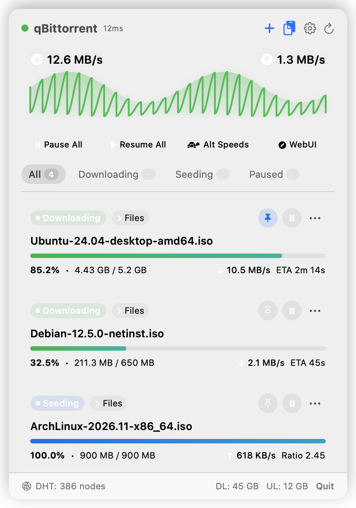

# QBMenubar - macOS 네이티브 qBittorrent 메뉴 막대 컨트롤러

  

  
  
  
  
  
  

  <a href="README.md">English</a> | 
  <a href="README_zh.md">简体中文</a> | 
  <a href="README_zh-Hant.md">繁體中文</a> | 
  <a href="README_ja.md">日本語</a> | 
  <b>한국어</b> | 
  <a href="README_de.md">Deutsch</a> | 
  <a href="README_fr.md">Français</a> | 
  <a href="README_es.md">Español</a> | 
  <a href="README_ru.md">Русский</a>

**QBMenubar**는 **Swift 6 + SwiftUI + MenuBarExtra (.window)** 로 제작된 가볍고 강력한 macOS 네이티브 상태 표시줄 컨트롤러입니다. 모던한 **Liquid Glass (액체 유리)** 반투명 머티리얼과 **Apple Motion Feel** 고유의 물리 스프링 애니메이션을 결합하여, CPU 0.1% 미만 및 RAM ~40MB의 극저전력으로 실시간 속도 모니터링, 고정 작업 진척률 표시, 원격 NAS WebUI 관리를 지원합니다.

  

---

## 🎯 주요 사용 시나리오 (Use Cases)

- 🚀 **로컬 클라이언트 및 원격 NAS 통합 제어**: 로컬 Mac, 시놀로지(Synology DSM), QNAP, Unraid, TrueNAS, Docker 컨테이너 또는 원격 클라우드 서버에서 실행 중인 qBittorrent를 내부 IP, 도메인, HTTPS 역방향 프록시를 통해 즉시 연결.
- 📌 **메뉴 막대에 핵심 토렌트 진척률 핀 고정**: 중요한 다운로드 작업을 1클릭으로 핀 고정하여 메뉴 막대 시계 옆에 실시간 진척도(예: `↓ 12.0 MB/s 85%`) 상시 확인.
- ⚡️ **배터리 걱정 없는 백그라운드 상주**: 무거운 일렉트론(Electron)이나 브라우저 탭과 달리, Swift 6 네이티브 코드로 대기 중 CPU 0.0%, 메모리 35~45MB만을 소비.
- 🐢 **회의 및 게임 중 원클릭 제한 전환**: 클릭 한 번으로 모든 다운로드 일시 정지/재개 및 대체 속도 제한(🐢 거북이 모드) 토글.
- 📋 **클립보드 스마트 감지 & 사전 파일 검사**: 클립보드의 마그넷(`magnet:`) 링크 자동 감지 및 로컬 `.torrent` 파일 내부 구조 사전 확인 지원.

---

## 📸 스크린샷 & 미리보기

  
  &nbsp;&nbsp;&nbsp;&nbsp;
  

---

## 📊 기능 비교: 왜 QBMenubar인가?

| 기능 | QBMenubar (네이티브) | 브라우저 WebUI | 공식 Qt 데스크톱 클라이언트 | Python / SwiftBar 플러그인 |
|---|:---:|:---:|:---:|:---:|
| **메뉴 막대 상주 및 인터랙션** | ✅ 네이티브 Liquid Glass | ❌ 브라우저 창 전용 | ❌ Dock/단독 창 전용 | ⚠️ 텍스트 메뉴 전용 |
| **특정 작업 진척도 핀 고정** | ✅ 상태 표시줄 흑백 배지 | ❌ | ❌ | ❌ |
| **실시간 동적 대역폭 파형** | ✅ Swift Charts 물리 파형 | ⚠️ 정적 꺾은선 | ⚠️ 기본 그래프 | ❌ |
| **메모리 사용량** | 🟢 **~35 - 45 MB** | 🔴 300 MB - 1 GB+ | 🟡 150 MB - 300 MB | 🟢 ~30 MB |
| **대기 중 CPU 점유율** | 🟢 **< 0.1%** | 🟡 1% - 5% | 🟡 1% - 3% | 🟡 1% - 2% |
| **원격 NAS & Docker 지원** | ✅ LAN / NAS / HTTPS 프록시 | ✅ | ❌ 로컬 인스턴스 전용 | ⚠️ 제한적 지원 |
| **확장형 파일 트리 미리보기** | ✅ 카드 내부 계층 확장 & 진척도 | ⚠️ 복잡한 표 반복 클릭 | ⚠️ 빽빽한 표 | ❌ |
| **macOS 네이티브 알림** | ✅ 다운로드 완료 시스템 푸시 | ⚠️ 브라우저 권한 필요 | ⚠️ 구형 알림창 | ❌ |

---

## 📥 다운로드 및 설치

### 방법 1: 사전 컴파일된 앱 다운로드 (권장)
개발 환경 설치 없이 바로 실행 가능합니다:

👉 **[최신 버전 QBMenubar 다운로드 (macOS)](https://github.com/133hou/QBMenubar/releases/latest)**

1. 다운로드한 `QBMenubar-*-macOS.zip`의 압축을 풉니다.
2. `QBMenubar.app`을 **「응용 프로그램 (/Applications)」** 폴더로 이동합니다.
3. **`QBMenubar.app`을 더블 클릭하여 실행**합니다! 메뉴 막대에 바로 상주합니다.

> [!TIP]
> **첫 실행 시 Gatekeeper 보안 경고 해결:**  
> 오픈소스 앱 첫 실행 시 "확인되지 않은 개발자" 알림이 나타나면, Finder에서 **`QBMenubar.app` 우클릭(또는 Control 누르고 클릭)** -> **「열기」** 를 선택해 주세요.

---

## 🏷️ 검색 키워드 (Keywords)
`qbittorrent` • `qbittorrent-controller` • `qbittorrent-webui` • `qbittorrent-client` • `macos-menubar` • `menubar-app` • `menubar-extra` • `swiftui` • `swift6` • `liquid-glass` • `torrent-client` • `torrent-manager` • `bittorrent` • `nas` • `synology` • `unraid`

---

## 📄 라이선스
이 프로젝트는 [MIT License](LICENSE)에 따라 오픈 소스로 배포됩니다.
