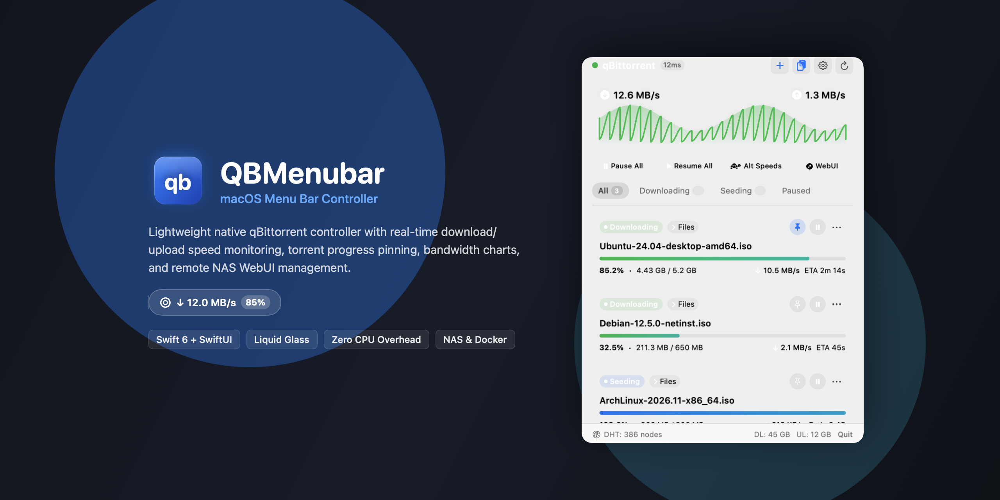

# QBMenubar - Нативный контроллер qBittorrent для строки меню macOS

  

  
  
  
  
  
  

  <a href="README.md">English</a> | 
  <a href="README_zh.md">简体中文</a> | 
  <a href="README_zh-Hant.md">繁體中文</a> | 
  <a href="README_ja.md">日本語</a> | 
  <a href="README_ko.md">한국어</a> | 
  <a href="README_de.md">Deutsch</a> | 
  <a href="README_fr.md">Français</a> | 
  <a href="README_es.md">Español</a> | 
  <b>Русский</b>

**QBMenubar** — это легкое, быстрое и полностью нативное приложение для **qBittorrent** в строке меню macOS, созданное с использованием **Swift 6 + SwiftUI + MenuBarExtra (.window)**. Сочетает визуальный стиль **Liquid Glass** и пружинную физику **Apple Motion Feel** для мониторинга скорости и управления загрузками прямо из строки меню с практически нулевым расходом ресурсов (CPU < 0,1%, RAM ~40 МБ).

  

---

## 🎯 Ключевые сценарии использования (Use Cases)

- 🚀 **Локальный клиент и удаленный NAS**: Управляйте qBittorrent на локальном Mac, Synology DSM, QNAP, Unraid, TrueNAS, в Docker-контейнерах или на серверах через локальный IP, домен или HTTPS обратный прокси.
- 📌 **Закрепление прогресса загрузки**: Закрепите процент выполнения важного торрента прямо рядом с системными часами (например: `↓ 12.0 MB/s 85%`).
- ⚡️ **Нулевая нагрузка на батарею**: В отличие от Electron-приложений или постоянных вкладок браузера, нативный Swift 6 код потребляет 0,0% CPU в режиме ожидания и всего 35–45 МБ оперативной памяти.
- 🐢 **Быстрые действия в один клик**: Мгновенно ставьте на паузу или возобновляйте все задачи, включайте альтернативное ограничение скорости (🐢 режим черепахи) во время звонков или игр.
- 📋 **Автоопределение ссылок и инспекция файлов**: Автоматическое чтение магнет-ссылок из буфера обмена и просмотр списка файлов `.torrent` перед началом загрузки.

---

## 📸 Скриншоты и интерфейс

  
  &nbsp;&nbsp;&nbsp;&nbsp;
  

---

## 📊 Сравнение: Почему именно QBMenubar?

| Функция | QBMenubar (Нативный) | Браузерный WebUI | Официальный Qt-клиент | Скрипты Python / SwiftBar |
|---|:---:|:---:|:---:|:---:|
| **Интеграция в строку меню** | ✅ Нативный Liquid Glass | ❌ Только в браузере | ❌ Только окно/Dock | ⚠️ Только текст |
| **Закрепление прогресса торрента** | ✅ Значок в строке меню | ❌ | ❌ | ❌ |
| **График волны трафика** | ✅ Плавные Swift Charts | ⚠️ Статический график | ⚠️ Простой график | ❌ |
| **Потребление памяти** | 🟢 **~35 - 45 МБ** | 🔴 300 МБ - 1 ГБ+ | 🟡 150 МБ - 300 МБ | 🟢 ~30 МБ |
| **Нагрузка на CPU в покое** | 🟢 **< 0,1%** | 🟡 1% - 5% | 🟡 1% - 3% | 🟡 1% - 2% |
| **Поддержка NAS и Docker** | ✅ LAN, NAS и HTTPS прокси | ✅ | ❌ Только локально | ⚠️ Ограниченно |
| **Интерактивное дерево файлов** | ✅ Раскрывающиеся карточки | ⚠️ Неудобные таблицы | ⚠️ Плотная таблица | ❌ |
| **Нативные уведомления macOS** | ✅ При завершении загрузки | ⚠️ Нужны права браузера | ⚠️ Устаревший диалог | ❌ |

---

## 📥 Загрузка и установка

### Способ 1: Готовое приложение (Рекомендуется)
Не требует установки Xcode или терминала:

👉 **[Скачать последнюю версию QBMenubar (macOS)](https://github.com/133hou/QBMenubar/releases/latest)**

1. Распакуйте архив `QBMenubar-*-macOS.zip`.
2. Перетащите `QBMenubar.app` в папку **«Программы (/Applications)»**.
3. **Дважды щелкните `QBMenubar.app` для запуска!** Приложение появится в строке меню.

> [!TIP]
> **Совет по безопасности Gatekeeper:**  
> Если macOS сообщает, что разработчик не может быть проверен: щелкните по `QBMenubar.app` **правой кнопкой мыши (или Control + клик)** в Finder и выберите **«Открыть»**.

---

## 🏷️ Поисковые ключевые слова (Keywords)
`qbittorrent` • `qbittorrent-controller` • `qbittorrent-webui` • `qbittorrent-client` • `macos-menubar` • `menubar-app` • `menubar-extra` • `swiftui` • `swift6` • `liquid-glass` • `torrent-client` • `torrent-manager` • `bittorrent` • `nas` • `synology` • `unraid`

---

## 📄 Лицензия
Распространяется под [лицензией MIT](LICENSE).
