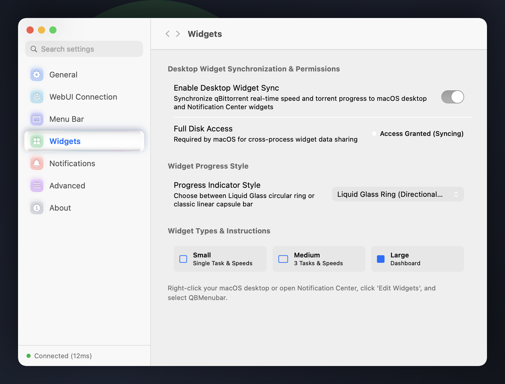

# ⚡️ QBMenubar — 原生 macOS qBittorrent & Transmission 選單列監控與桌面小工具客戶端

<p align="center">
  
</p>

<p align="center">
  <a href="https://github.com/133hou/QBMenubar/releases"></a>
  <a href="https://github.com/133hou/QBMenubar/releases"></a>
  
  
  
  
  
  
</p>

<p align="center">
  <a href="README.md">English</a> | 
  <a href="README_zh.md">简体中文</a> | 
  <b>繁體中文</b> | 
  <a href="README_ja.md">日本語</a> | 
  <a href="README_ko.md">한국어</a> | 
  <a href="README_de.md">Deutsch</a> | 
  <a href="README_fr.md">Français</a> | 
  <a href="README_es.md">Español</a> | 
  <a href="README_ru.md">Русский</a>
</p>

**QBMenubar** 是一款基於 **Swift 6 + SwiftUI + MenuBarExtra (.window)** 純原生開發的 macOS 選單列控制應用。融合現代 **Liquid Glass（液態玻璃）** 半透明材質與 **Apple Motion Feel** 原生物理彈簧動效，為您提供近乎零資源開銷（CPU < 0.1%，記憶體 ~40MB）的 qBittorrent 即時速率監控、圖釘任務進度直顯與遠端 NAS WebUI 深度管理體驗。

<p align="center">
  
</p>

---

## 🎯 核心使用場景

- 🚀 **本地客戶端與遠端 NAS 雙向監控**：無論 qBittorrent 運行在本地 Mac、群暉（Synology DSM）、威聯通（QNAP）、Unraid、TrueNAS、Docker 容器還是雲端 VPS / Seedbox，只需配置 WebUI 位址（支援內網 IP、網域名稱與 HTTPS 反向代理）即可無縫秒級同步。
- 📌 **關鍵任務選單列圖釘置頂**：點擊卡片右上角圖釘，將正在下載的關鍵種子進度百分比直接固定在螢幕頂部的系統選單列（例如：`↓ 12.0 MB/s 85%`），無需切換視窗。
- ⚡️ **無感低功耗背景常駐**：基於 Swift 6 編譯型原生代碼開發，相較於臃腫的 Electron 包裝器或常開瀏覽器分頁，日常靜默運行 CPU 佔用接近 0.0%，記憶體僅佔用 ~35-45 MB，完全不損耗電池續航。
- 🐢 **會議與遊戲一鍵限速**：頂部快捷面板一鍵暫停所有任務、一鍵繼續，或快速開啟備用限速（🐢 小烏龜模式），開會打遊戲不再被下載搶佔頻寬。
- 📋 **磁力與種子智慧捕獲**：自動識別系統剪貼簿中的 `magnet:` 磁力連結或 HTTP 種子連結，並支援上傳本地 `.torrent` 檔案在下載前預覽內部檔案目錄。

---

## 📸 介面預覽與實機效果

<p align="center">
  
  &nbsp;&nbsp;&nbsp;&nbsp;
  
</p>

<p align="center">
  
</p>
<p align="center">
  
</p>
<p align="center">
  
</p>

---

## 📊 深度比較：為什麼選擇 QBMenubar？

| 功能維度 | QBMenubar (原生) | 瀏覽器 WebUI 網頁 | 官方 Qt 客戶端 | Python / SwiftBar 腳本外掛 |
|---|:---:|:---:|:---:|:---:|
| **雙客戶端引擎** | ✅ **qBittorrent & Transmission** | ❌ 僅限單個實例 | ❌ 僅限 qBittorrent | ⚠️ 僅限特定腳本 |
| **選單列常駐與互動** | ✅ 原生 Liquid Glass 彈窗 | ❌ 僅限網頁視窗 | ❌ 僅限 Dock / 獨立主窗 | ⚠️ 純文字下拉選單（無互動卡片） |
| **選單列圖釘任務進度** | ✅ 選單列黑白單色徽章直顯 | ❌ | ❌ | ❌ |
| **即時動態頻寬波形圖** | ✅ Swift Charts 平滑物理波形 | ⚠️ 靜態更新折線 | ⚠️ 簡易折線 | ❌ |
| **可拉伸視窗高度** | ✅ 底部把手自由拖曳 (380-920pt) | ⚠️ 手動調整網頁 | ⚠️ 複雜桌面視窗 | ❌ 固定純文字 |
| **記憶體佔用** | 🟢 **~35 - 45 MB** | 🔴 300 MB - 1 GB+ | 🟡 150 MB - 300 MB | 🟢 ~30 MB |
| **背景閒置 CPU** | 🟢 **< 0.1%** | 🟡 1% - 5% | 🟡 1% - 3% | 🟡 1% - 2% |
| **遠端 NAS / Docker 連線** | ✅ 本地、內網 NAS 與網域反代 | ✅ | ❌ 僅支援本機行程 | ⚠️ 鑑權與反代支援有限 |
| **互動式檔案樹穿透展開** | ✅ 原生卡片層級展開與單檔案進度 | ⚠️ 複雜表格多次點擊 | ⚠️ 密集表格 | ❌ |
| **桌面與通知中心小工具 (WidgetKit)** | ✅ 支援小/中/大三種尺寸 | ❌ | ❌ | ❌ |
| **macOS 系統通知推播** | ✅ 任務下載完成原生通知 | ⚠️ 需瀏覽器權限常駐 | ⚠️ 舊式彈窗 | ❌ |

---

## ✨ 核心特性一覽

1. **選單列常駐與動態監控**：
   - 即時上傳 / 下載速率與動態方向圖示（`↓` / `↑`）。
   - 專屬任務完成度百分比直顯（黑白單色半透明膠囊，完美融入選單列）。
   - 文字寬度自動擴展，徹底杜絕 AppKit 選單列文字裁切與截斷。
2. **Liquid Glass 現代毛玻璃主彈窗**：
   - 遵循 macOS 液態材質設計，高光鏡面邊緣與微光倒影。
   - **即時動態頻寬波形圖**（Swift Charts），平滑呈現流量起伏。
   - 頂部快捷操作列：暫停全部、全部繼續、備用限速（🐢 小烏龜）、一鍵直達 WebUI。
   - 分類過濾標籤：全部、下載中、做種中、已暫停。
   - **➕ 本地種子上傳**：支援解析 `.torrent` 檔案，在添加前預覽內部檔案清單並自訂儲存目錄。
   - **📋 剪貼簿快速添加**：一鍵識別磁力連結（`magnet:`）或 HTTP/HTTPS 種子連結。
3. **互動式種子卡片 & 檔案穿透展開**：
   - 清晰呈現任務名、狀態徽章、漸變進度條、已完成體積、ETA 剩餘時間與速率。
   - **點擊卡片流暢展開內部檔案列表**：直觀展示每一個檔案的專屬類型圖示、檔案名、體積與獨立下載百分比。
   - **📌 圖釘一鍵置頂**：點擊卡片右上角圖釘，將指定任務的下載進度鎖定到 macOS 選單列展示。
   - 右鍵選單支援在 Finder 中定位、重新校驗完整性、刪除任務（支援選擇是否保留本地檔案）。
4. **macOS 系統設定風格偏好面板**：
   - 原生固定雙欄佈局，徹底杜絕側邊欄折疊按鈕。
   - 全面支援自訂 WebUI API（支援本地 `127.0.0.1:8080`、區域網路 NAS、遠端 VPS 或 HTTPS 反代網域）。
   - 內建**連通性測試器**：一鍵探測延遲（Ping）與 qBittorrent 伺服端版本。
   - 支援 macOS 原生系統通知（任務開始下載與下載完成提醒）。
   - 完整 9 種語言本地化支援（繁體中文、簡體中文、English、日本語、한국어、Deutsch、Français、Español、Русский）。
5. **macOS 桌面與通知中心小工具 (WidgetKit)**：
   - **小號組件 (.systemSmall)**：單任務焦點進度卡片，直觀顯示最活躍任務進度條、當前速度與剩餘時間 (ETA)。
   - **中號組件 (.systemMedium)**：雙欄佈局，左側顯示全域即時上傳下載頻寬與任務計數，右側列出前 2-3 個活躍下載任務進度。
   - **大號組件 (.systemLarge)**：全功能任務看板，包含多任務進度、狀態標籤、傳輸統計與一鍵跳轉。
   - **零開銷 App Group 共享儲存**：主應用與小組件處理程序間極速低耗同步。
   - 完美適配 macOS 全彩、深色以及著色/高亮模式 (`widgetAccentable`)。

### 🧩 桌面小工具與系統權限指南

QBMenubar 原生支援 macOS 桌面與通知中心小工具（提供 Small、Medium、Large 三種尺寸）。主程式與小工具之間透過高效的本地快照進行資料同步：

1. **在設定中啟用**：點擊選單列圖示開啟「偏好設定」(**⌘,**) -> 進入「**小工具**」標籤頁 -> 開啟「**啟用桌面小工具同步**」。
2. **macOS「其他 App 的資料」系統權限說明**：
   - **為什麼會出現系統彈窗**：在 macOS 15 (Sequoia) 和 macOS 26 (Tahoe) 中，選單列主程式與沙盒化的小工具擴充（WidgetKit Extension）屬於獨立行程，需透過 Apple 標準的 App Group 共享目錄（`~/Library/Group Containers/`）傳遞任務進度。由於開源專案採用本地自簽名（未附加每年 $99 的 Apple 商業開發者 Team ID 設定檔），macOS 會自動將該跨行程共享目錄標記為「其他 App 的資料」，並彈出警告：*“QBMenubar 嘗試存取來自其他 App 的資料並已被封鎖”*。
   - **🔒 零隱私風險承諾**：QBMenubar **僅**在共享目錄中讀寫自身的 `widget_snapshot.json` 快照（僅包含當前任務名稱、上下行速度及進度百分比），**絕不掃描或讀取您的任何個人隱私檔案或其他軟體資料**。
   - **如何授權或恢復權限**：
     - **方案 1（應用程式內一鍵重新觸發）**：在「偏好設定 -> 小工具」頁面中，點擊「**重新觸發系統權限彈窗**」，系統將立即再次彈出授權提示，點擊「管理」並允許即可。
     - **方案 2（系統設定）**：開啟「**系統設定 > 隱私權與安全性 > 檔案與資料夾**」（或「**全能磁碟存取權限**」），找到 **QBMenubar** 並勾選允許。
     - **方案 3（終端機重設）**：若先前點擊了拒絕且在系統設定清單中未找到 QBMenubar，只需在終端機中執行：
       ```bash
       tccutil reset All com.antigravity.QBMenubar
       ```
       隨後重新開啟 QBMenubar 並開啟小工具開關，即可重新彈出系統授權提示。
   - **注意事項**：桌面小工具必須獲得該資料共享權限才能即時更新；若未授權，小工具將顯示「需資料存取權限」狀態。**即使不授予該權限，選單列的所有監控、控制、磁力連結抓取等核心功能依然 100% 正常運作，完全不受影響。**

---

### 🚀 v1.3.2 更新亮點
- **新增 Transmission 客戶端原生支援**：架構抽象解耦，原生對接 Transmission JSON-RPC 協定（自動處理 409 CSRF Session-Id 握手與 Basic Auth 鑑權）。現已完美支援 qBittorrent 與 Transmission 雙客戶端無縫切換，桌面小工具、速度折線圖與加入任務完全通用。
- **設定側邊欄高透液態玻璃光學透鏡**：復刻原生 macOS Tahoe 水晶液態玻璃透鏡質感，具備上下凹面物理折射陰影、邊緣棱鏡色彩色散與平滑彈簧滑行動畫（原經典純色高亮樣式完整保留，可在通用設定中自由切換）。
- **小工具液態玻璃環形進度圈**：新增帶流光導向箭頭的環形進度儀表盤與中央懸浮玻璃圓角狀態指示器（經典橫向膠囊進度條 100% 保留，可在偏好設定 -> 小工具中按需切換）。
- **原生 WidgetKit 擴充套件入口點適配**：連結器正式補齊 `_NSExtensionMain` 符號入口，使系統 `chronod` 與通知中心能夠穩定喚起外掛並預載 Small、Medium、Large 桌面小工具佔位圖與描述符。
- **簡化「全能磁碟存取權限」授權流程**：徹底精簡小工具權限配置，直通 macOS 全能磁碟存取權限，消除冗餘按鈕，修復卡片邊框溢出與文字截斷問題。
- **單一應用程式包生命週期最佳化**：清理多餘的構建註銷與 LaunchServices 快取衝突，確保系統小工具庫即時感知與更新。

---

## 📥 下載安裝與執行

### 方式 1：直接下載執行檔（推薦，開箱即用）
無需安裝 Xcode 或終端機環境，直接下載預編譯打包好的 macOS 原生應用：

👉 **[下載最新版 QBMenubar (Latest) (macOS)](https://github.com/133hou/QBMenubar/releases/latest)**

1. 下載後按兩下解壓縮出 `QBMenubar.app`；
2. 將其拖入訪達的 **「應用程式 (/Applications)」** 資料夾中；
3. **按兩下 `QBMenubar.app` 即可直接執行**！應用將靜默常駐在螢幕頂部的系統選單列。

> [!TIP]
> **首次執行安全提示（Gatekeeper）：**  
> 開源應用首次打開時，macOS 可能會彈出 *“無法打開，因為無法驗證開發者”* 提示。  
> 解決方法：在訪達的「應用程式」中，**按右鍵（或按住 Control 點擊）`QBMenubar.app`** -> 選擇 **「打開」** -> 在彈窗中點擊 **「打開」** 即可正常放行。  
> 或在終端機中執行一行指令清除隔離屬性：`xattr -cr /Applications/QBMenubar.app`

### 方式 2：從原始碼本地編譯 (Build from Source)
執行環境：macOS 14.0+，Xcode 15+ / Swift 6.0+。

```bash
git clone https://github.com/133hou/QBMenubar.git
cd QBMenubar
swift build -c release
./build_app.sh
open QBMenubar.app
```

---

## ⚙️ 首次使用配置步驟（1 分鐘快速上手）

### qBittorrent 使用者：
1. **啟用 WebUI**：打開 qBittorrent -> **偏好設定 (Preferences) -> Web UI**，勾選 **Web 使用者介面 (遠端控制)**（預設埠 `8080`）。
2. **連線 QBMenubar**：打開 QBMenubar 設定 -> **WebUI 連線**，客戶端選擇 **qBittorrent**，檢查位址（預設 `http://127.0.0.1:8080`、API 前綴 `/api/v2`），輸入帳號密碼後點擊 **測試連線**。

### Transmission 使用者：
1. **啟用遠端存取**：打開 Transmission -> **偏好設定 -> 遠端 (Remote)**，勾選 **啟用遠端存取**（預設埠 `9091`）。
2. **連線 QBMenubar**：打開 QBMenubar 設定 -> **WebUI 連線**，將客戶端類型切換為 **Transmission**，位址將自動預設為 `http://127.0.0.1:9091` 與 `/transmission/rpc`，若設定了密碼請輸入後點擊 **測試連線** 即可！

---

## ❓ 常見問題與解答 (FAQ)

<details>
<summary><b>1. QBMenubar 支援同時連線或切換 qBittorrent 與 Transmission 嗎？</b></summary>
是的！QBMenubar 具備統一的服務抽象層。您只需在「設定 -> WebUI 連線」中選擇 <b>qBittorrent</b> 或 <b>Transmission</b>，選單列即時速率、展開卡片、折線圖與桌面小工具均全面無縫相容。
</details>

<details>
<summary><b>2. 如何連線群暉 Synology、TrueNAS、威聯通 QNAP 或 Docker 中的下載器？</b></summary>
只需在「伺服器位址」一欄填入 NAS 的區域網路 IP（例如 <code>http://192.168.1.100:8080</code> 或 <code>http://nas.local:9091</code>）、自訂網域或 HTTPS 反向代理位址即可。QBMenubar 原生支援反向代理子路徑與基礎認證。
</details>

<details>
<summary><b>3. 如何在 macOS Sonoma、Sequoia 或 Tahoe 桌面加入小工具？</b></summary>
在 Mac 桌面空白處按右鍵<b>「編輯小工具」</b>（或在通知中心底部點擊），搜尋 <b>QBMenubar</b>，即可將<b>小（Small）</b>、<b>中（Medium）</b>或<b>大（Large）</b>規格的小工具拖至桌面或通知中心。您還可以在設定中自由選擇<b>液態玻璃環形圈</b>或<b>經典橫向膠囊條</b>樣式。
</details>

<details>
<summary><b>4. 為什麼 QBMenubar 的記憶體佔用只有 40MB，而網頁端佔用幾百 MB？</b></summary>
QBMenubar 採用純原生 <b>Swift 6 + SwiftUI</b> 開發，零內嵌網頁、零 Chromium/Electron 臃腫執行環境，直接以原生網路協定並發調度，閒置時 CPU 佔用近乎為零（<0.1%），極為節能省電。
</details>

<details>
<summary><b>5. 選單列彈出的控制視窗可以拉長放大嗎？</b></summary>
完全可以！點擊選單列彈出面板後，將滑鼠移至面板<b>最底部正中央的原生拖曳把手</b>，滑鼠變為上下箭頭後即可在 <b>380pt ~ 920pt</b> 之間任意拖曳拉伸視窗高度。高度會自動記住，按兩下把手可一鍵平滑彈回預設 550pt 高度。
</details>

---

## 🏷️ 搜尋關鍵字與索引標籤 (Keywords)
`qbittorrent` • `transmission` • `qbittorrent-controller` • `transmission-remote` • `qbittorrent-webui` • `transmission-rpc` • `macos-menubar` • `menubar-app` • `menubar-extra` • `widgetkit` • `desktop-widgets` • `swiftui` • `swift6` • `liquid-glass` • `torrent-client` • `torrent-manager` • `bittorrent` • `nas` • `synology` • `unraid` • `truenas` • `qnap` • `docker` • `apple-silicon` • `macos-tahoe` • `macos-sequoia` • `macos-sonoma`

---

## 📄 開源許可協議
本專案採用 [MIT License](LICENSE) 授權開源。
